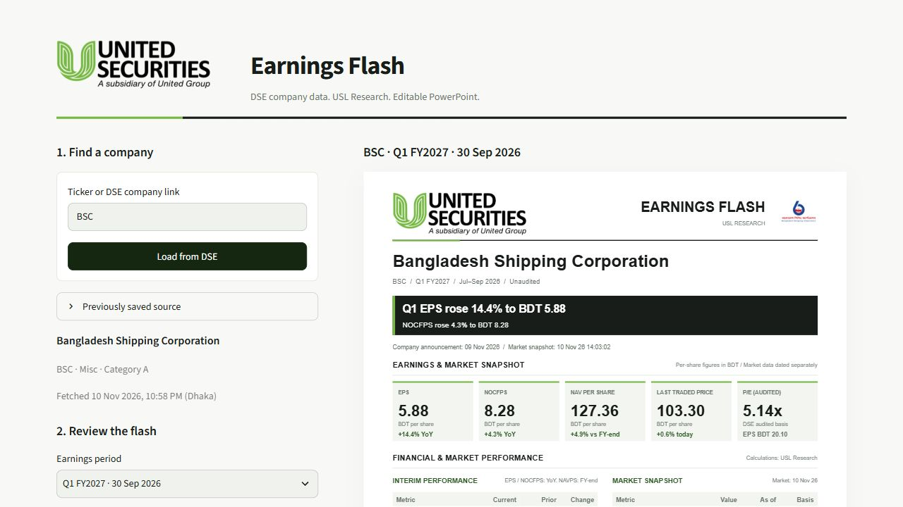
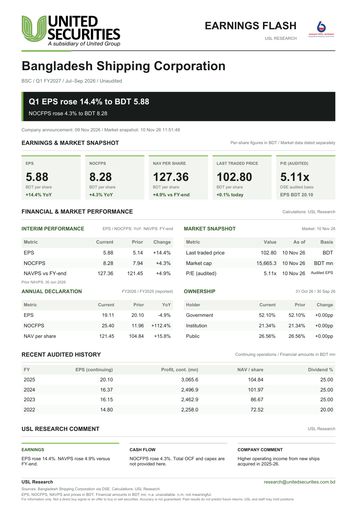

# Earnings Flash Generator — Portfolio Showcase

A static case study for a CV or project portfolio. Open `index.html` in a browser or serve this folder through a static host.

This folder contains only the case-study page and PNG previews. It does not include the application source, executables, templates, financial export files, saved data, credentials or local filesystem paths. The full app repository stays private.

The project automates DSE-disclosure parsing, reporting-period checks, issuer-logo retrieval and PowerPoint/PDF reporting using Python, Streamlit and a C# Windows launcher. It includes 46 regression checks. Source is available to reviewers on request.

The previews use public company disclosures and dated market figures. They demonstrate the software rather than an investment recommendation.
